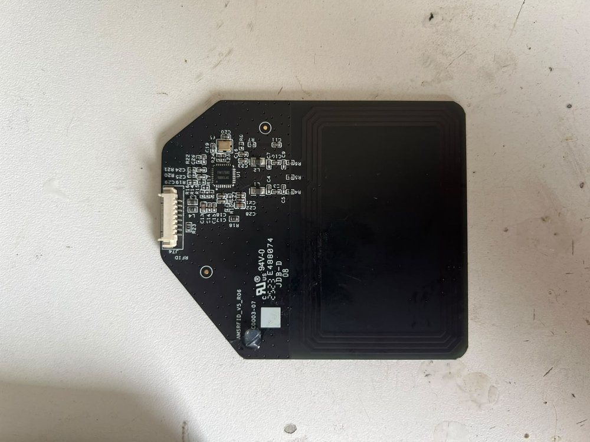
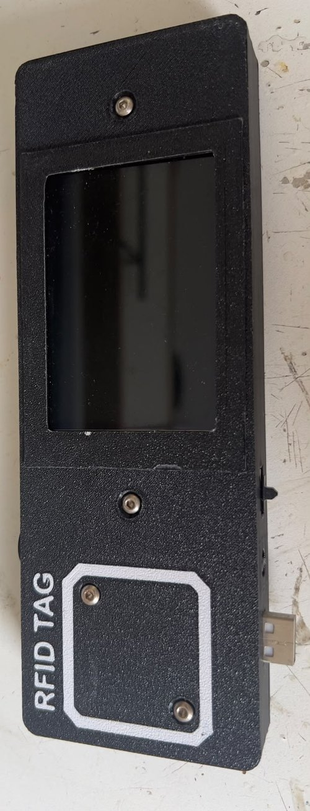

# Bambu AMS RFID Filament Tracker

   

Automatic filament tracking for a **Bambu Lab P1S + AMS** using third-party (non-Bambu) spools.
Each spool carries a cheap NFC/RFID sticker. When a spool is inserted into an AMS tray, Home Assistant
asks an ESP32 to read the tag, looks the UID up in **Spoolman**, and assigns the right spool to the right
tray in **Bambuddy**, so there's no manual selection in the slicer.

The ESP32 reads tags using the **AMS's own RFID reader board**, tapped directly over SPI.

```
 AMS tray inserted ──► Home Assistant ──GET /scan?reader=A|B──► ESP32 ──SPI──► AMS RFID board (FM17580) / PN532
                              ▲                                   │
                              └──── POST webhook {tag_uid, reader}┘
                              │
                              ├──► Spoolman  (link spool ↔ tray)
                              └──► Bambuddy  (assign spool to AMS slot)
```

## What's in this repo

| Folder | What it is |
|---|---|
| [`esp32-ams-reader/`](esp32-ams-reader) | Main firmware. ESP32 wired to **two readers on one SPI bus**: the AMS's original RFID board for trays 1–2 and a PN532 for trays 3–4. Exposes an HTTP API for Home Assistant, posts tag UIDs to an HA webhook, has a **built-in web serial monitor** and **OTA updates**. |
| [`esp8266-nfc-display/`](esp8266-nfc-display) | **Tag registration station**: a stand-alone ESP8266 + PN532 reader in a 3D-printed case that shows the UID of a new tag on a 3.5" HX8357 display. |
| [`esphome/`](esphome) | Alternative ESPHome version of a single-reader tag scanner that fires a Home Assistant event. |
| [`home-assistant/`](home-assistant) | The automations, script and helpers that run the whole flow. |

## Hardware

### Reader A: the Bambu AMS RFID board (trays 1 & 2)



The AMS has two internal RFID boards (`AMSRFID_V5_R06`), each covering two trays. They use a
**Fudan FM17580**, which is register-compatible with the NXP MFRC522, so the standard `MFRC522`
Arduino library drives it directly. Instead of adding new readers, the ESP32 talks to the AMS board
through its 8-pin connector (`J74`).

**J74 connector pinout** (pin 1 on the left, viewed from the component side):

| Pin | Signal | ESP32 |
|---|---|---|
| 1 | GND | GND |
| 2 | MISO | GPIO 19 |
| 3 | MOSI | GPIO 23 |
| 4 | SCK | GPIO 18 |
| 5 | CS (NSS) or RST *(see note)* | GPIO 5 (CS) / GPIO 22 (RST) |
| 6 | CS (NSS) or RST *(see note)* | GPIO 5 (CS) / GPIO 22 (RST) |
| 7 | Antenna GND | — |
| 8 | VCC 3.3 V | 3V3 |

> **Note on pins 5 & 6:** the firmware uses exactly two control lines besides SPI: **CS = GPIO 5**
> and **RST = GPIO 22**. These are the two lines on pins 5 and 6, but which pin is which still has to be
> confirmed with a continuity test to the FM17580's NSS and NRSTPD pins.

### Reader B: PN532 (trays 3 & 4)
The second AMS RFID board was damaged during testing, so trays 3–4 use a **PN532** module in SPI mode
(DIP switches: SW1 OFF, SW2 ON) on the same bus with its own chip-select (**GPIO 15**). The firmware handles
both chips and outputs the same UID format from each.

### Shared SPI bus

| Signal | ESP32 | Reader A (AMS board) | Reader B (PN532) |
|---|---|---|---|
| SCK | 18 | J74 pin 4 | SCK |
| MISO | 19 | J74 pin 2 | MISO |
| MOSI | 23 | J74 pin 3 | MOSI |
| CS | 5 / 15 | J74 pin 5/6 | SS |
| RST | 22 | J74 pin 5/6 | — |

## ESP32 AMS reader: features
- Two different RFID chips (FM17580/MFRC522 + PN532) sharing one SPI bus with independent chip-selects
- HTTP endpoints: `/scan?reader=A|B&ignore=<uid>`, `/status`, `/` (web log UI), `/log`, `/log/clear`
- "Ignore UID" so the reader skips the neighbouring spool, which is also in range of the same board
- Sends `TIMEOUT` when no tag is found so HA can rotate the spool and retry
- 200-line ring-buffer log mirrored from `Serial` to a web page, for debugging without a USB cable
- ArduinoOTA for wireless firmware updates

**Libraries:** `MFRC522` (GithubCommunity), `Adafruit PN532`, ESP32 Arduino core (WiFi, HTTPClient, WebServer, ArduinoOTA)

**Setup**
1. Copy `esp32-ams-reader/secrets.example.h` → `secrets.h` and fill in WiFi + a Home Assistant long-lived token.
2. Flash with Arduino IDE (board: ESP32 Dev Module).

## Registering a new tag



Before a spool can be tracked, its tag UID has to be linked to a Spoolman spool ID once:

1. **Read the tag UID.** Hold the tag on the *RFID TAG* pad of the registration station
   ([`esp8266-nfc-display/`](esp8266-nfc-display)) and the UID appears on the screen.
   *No dedicated hardware needed:* any phone with NFC and an app such as NFC Tools shows the same UID.
   The station exists so this can be done at the bench without a phone.
2. **Run the Home Assistant script** *Register RFID Tag to Spoolman* with the Spoolman spool ID and the UID.
   Any separator format works (`04-33-96-91-C9-2A-81` or `04339691C92A81`).
3. The script normalises the UID to 16 upper-case hex characters, registers it in Spoolman
   (`rest_command.spoolman_tag_register`), and saves it to **`/config/filament_tag_map.json`**
   through a pyscript service (`pyscript.save_filament_tag_map`, see
   [`home-assistant/pyscript/filament_tag_map.py`](home-assistant/pyscript/filament_tag_map.py)).
   If the spool already had another tag, the old UID is removed, so one spool always has one tag.
4. A `command_line` sensor, **`sensor.filament_tag_map`**, reads that JSON file and exposes it as the
   `tags` attribute. The *assign filament to tray* automation looks scanned UIDs up there:

```json
{
  "04339691C92A8100": { "spoolman_id": 10, "friendly_name": "Spoolman ID 10" },
  "04EC9A91C92A8100": { "spoolman_id": 4,  "friendly_name": "Spoolman ID 4" }
}
```

From then on, inserting that spool into any AMS tray assigns it automatically.

**Registration station hardware:** ESP8266 + PN532 over I²C (SDA 4 / SCL 5) and an HX8357 display on
HSPI (GPIO 12–15) in a 3D-printed case; the screen turns off after 5 s and wakes on the next tag.
The HX8357 9-bit SPI driver is adapted from
[robin7331/malyan-m200-display-firmware](https://github.com/robin7331/malyan-m200-display-firmware) (MIT, see `LICENSE-HX8357-driver`);
`sdk_drivers/` are Espressif ESP8266 NONOS SDK SPI drivers.

## Home Assistant flow
| Automation | Role |
|---|---|
| `01_tray_insert_trigger_scan` | Tray goes Empty → filament: queue a scan, store the active tray, call the ESP32 |
| `02_scan_assign_filament_to_tray` | Webhook with UID: normalise UID, look it up in `sensor.filament_tag_map`, unlink the old spool, link the new one in Spoolman, assign it in Bambuddy |
| `03_scan_timeout_spool_rotation` | Webhook with `TIMEOUT`: rotate the spool (`bambu_lab.read_rfid`) and retry up to N times |
| `04_tray_remove_unlink_spool` | Tray emptied: unlink the spool from Spoolman and Bambuddy |
| `05_spoolman_register_from_sidebar` | Opens the tag-registration script dialog |
| `06_bambuddy_sync_ams_slots` | Mirrors Bambuddy slot presets / spool IDs into helpers for the dashboard |

### Files in [`home-assistant/`](home-assistant)

| File | Purpose |
|---|---|
| `automations/*.yaml` | The six automations above |
| `scripts/register_rfid_tag_to_spoolman.yaml` | Tag registration script |
| `pyscript/filament_tag_map.py` | `pyscript.save_filament_tag_map` service: normalises the UID, removes any old UID for the same spool, writes and re-verifies `filament_tag_map.json` |
| `rest_command.yaml` | Calls to Bambuddy (Spoolman inventory, tag register, link/unlink, AMS slot assign/unassign, slot presets) and to the ESP32 scan endpoints |
| `configuration.example.yaml` | `rest_command` include, `pyscript` settings, the `command_line` sensor that exposes the tag map, optional Bambuddy sidebar panel |
| `helpers.yaml` | `input_text` / `input_number` / `counter` helpers |
| `filament_tag_map.example.json` | Format of the tag map file |
| `secrets.example.yaml` | Secret names used by `rest_command.yaml` |

### Home Assistant setup

**Requirements:** [Bambu Lab integration](https://github.com/greghesp/ha-bambulab) (AMS tray sensors and `bambu_lab.read_rfid`),
[Bambuddy](https://github.com/maziggy/bambuddy) with Spoolman inventory enabled, [pyscript](https://github.com/custom-components/pyscript) (HACS),
and [browser_mod](https://github.com/thomasloven/hass-browser_mod) (only for automation 05).

1. **Set your own addresses.** In `rest_command.yaml`, replace every `YOUR_BAMBUDDY_IP` with your Bambuddy
   server's IP or hostname, and `YOUR_ESP32_IP` with the ESP32 reader's IP. Give the ESP32 a fixed IP
   (DHCP reservation on your router) so it doesn't change. Do the same for `panel_iframe` in
   `configuration.example.yaml` if you use it.
2. **Add the API key.** Create an API key in Bambuddy and add it to `/config/secrets.yaml`
   as `bambuddy_api_key` (see `secrets.example.yaml`).
3. **Copy the files** to your Home Assistant `/config` folder:
   `rest_command.yaml` → `/config/rest_command.yaml`,
   `pyscript/filament_tag_map.py` → `/config/pyscript/filament_tag_map.py`.
4. **Create the tag map file:** `/config/filament_tag_map.json` containing just `{}`.
5. **Merge `configuration.example.yaml`** into your `configuration.yaml`
   (`rest_command`, `pyscript`, `command_line` sensor).
6. **Create the helpers** from `helpers.yaml` (in YAML or via *Settings → Devices & services → Helpers*).
7. **Import the automations and the script.** Replace `<printer_serial>` in the entity IDs with your
   printer's serial (e.g. `sensor.p1s_<serial>_ams_1_tray_1`).
8. **Restart Home Assistant**, then check that `sensor.filament_tag_map` has state `active`.
9. On the ESP32 side, set `HA_HOST` in `secrets.h` to your Home Assistant URL. The firmware posts to the
   webhook `arduino_rfid_scanned`, which automations 02 and 03 listen on.

## Development history
This went through ~15 iterations: reading the AMS board alone → two readers → AMS board + PN532
(I²C, then SPI) → HTTP scan windows → web log → OTA + ignore-UID logic. Only the final versions are published here.
